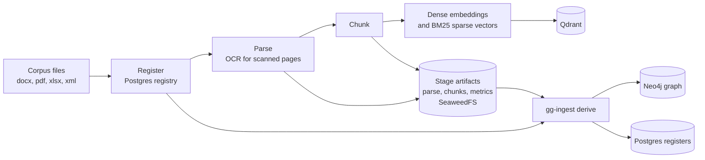
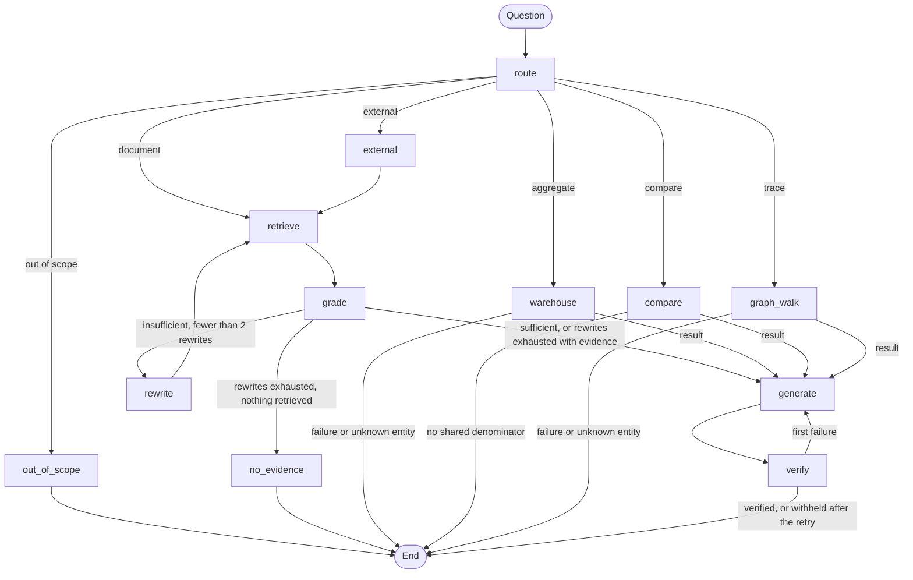

# Golden Goose

Agentic question answering over a medical device quality management system, built for regulatory
audit support: a LangGraph agent over hybrid retrieval (Qdrant), a knowledge graph (Neo4j) and a
record warehouse (Postgres), with every answer cited to document ID, revision and page.

## What it does

- Answers questions about controlled documents, quality records and design controls, with
  document ID, revision and page citations in each answer
  ([`docs/validation/intended-use.md`](docs/validation/intended-use.md)).
- Routes count questions to the Postgres register warehouse and trace questions to fixed Neo4j
  traversals. Rate comparison questions get a warehouse count and an external count, reported
  separately because no shared denominator is available
  ([`packages/agents/src/gg_agents/graph.py`](packages/agents/src/gg_agents/graph.py),
  `compare` in [`nodes.py`](packages/agents/src/gg_agents/nodes.py)).
- Queries external regulatory sources: openFDA, eCFR, ClinicalTrials.gov, PubMed and web search
  ([`packages/retrieval/src/gg_retrieval/tools/external/`](packages/retrieval/src/gg_retrieval/tools/external/)).
- Draws one record's neighbourhood in the knowledge graph in the web app's Trace view. Links
  read from a form field are solid, links mined from document text are dashed, and each link
  shows its source document, field or page, extraction method and confidence
  (`GET /graph/trace`, [`apps/api/src/goldengoose_api/graph_trace.py`](apps/api/src/goldengoose_api/graph_trace.py)).
- Writes every chat turn to an append-only, hash-chained audit log
  ([ADR 0010](docs/adr/0010-append-only-audit-log.md)).
- Generates its own test corpus: a synthetic QMS for the fictional Halvern Medical infusion pump
  family, with a golden question set and seeded defects
  ([`packages/synthdata/`](packages/synthdata/)).
- Runs a gated eval battery covering retrieval recall, answer grounding, citation precision and
  recall, sentence support, routing accuracy and reranker noise. CI runs it on the 30-question
  smoke set for each push and pull request, and a nightly workflow runs the full golden set
  ([`.github/workflows/`](.github/workflows/), [ADR 0019](docs/adr/0019-eval-battery-lexical-gates.md)).

## How it works

Ingestion registers each file in a Postgres registry, parses it, chunks it, and indexes dense
and BM25 sparse vectors in one Qdrant collection. Stage outputs are stored in SeaweedFS keyed by
content hash ([`pipeline.py`](packages/ingestion/src/gg_ingestion/pipeline.py)). A separate
`derive` step reads the parsed artifacts of the latest indexed version of each document and
rebuilds the Neo4j graph and the Postgres registers on every run
([ADR 0014](docs/adr/0014-graph-and-registers-as-rebuildable-projections.md)).



At question time a deterministic regex router runs first and the LLM router handles the rest
([ADR 0016](docs/adr/0016-deterministic-tool-routing.md)). Document questions go through hybrid
search with reciprocal rank fusion and a reranker, a sufficiency grade, up to 2 query rewrites,
generation, and a citation verifier that allows one regeneration before it withholds the answer
([`packages/agents/src/gg_agents/state.py`](packages/agents/src/gg_agents/state.py),
[`nodes.py`](packages/agents/src/gg_agents/nodes.py)). If the rewrites are exhausted and some
evidence was retrieved, generation runs and the verifier decides. Tool nodes hand their result to
generation, and end the turn on a tool failure or when the question names an entity that is not
in the corpus. The compare node also ends the turn when no shared denominator exists, which is
the case for every comparison at present.



## Results

Evaluation results depend on the synthetic example Action Priority table and on the provider
configuration (deterministic fakes when no API keys are set). This repository does not publish
figures. Run the commands in the Quickstart (`synthdata generate`, `gg-ingest run`,
`gg-ingest derive`, `gg-eval battery`) to produce them for your own environment.

## Quickstart

Requirements: Docker with Compose, [uv](https://docs.astral.sh/uv/) (it installs the required
Python 3.13), and Node 22 for the web UI, the version CI and `Dockerfile.web` use. No API keys
are needed; without them every provider is a deterministic fake.

```bash
git clone https://github.com/darblinko/golden-goose
cd golden-goose
uv sync --locked
uv run pytest                       # unit tests, no services needed
```

Start the stores, build the corpus and run the battery:

```bash
docker compose -f infra/compose/docker-compose.yml --profile core up -d --wait
uv run alembic -c infra/migrations/alembic.ini upgrade head
uv run synthdata generate --out /tmp/gg-corpus --seed 42
uv run gg-ingest run --corpus /tmp/gg-corpus/corpus
uv run gg-ingest graph-migrate
uv run gg-ingest derive
uv run gg-eval battery --qa /tmp/gg-corpus/qa/golden_qa.json --out /tmp/gg-battery.json
```

The stores bind 127.0.0.1 ports 5432 (Postgres), 6333 and 6334 (Qdrant), 7474 and 7687 (Neo4j)
and 8333 (SeaweedFS). If one is taken, remap it in a compose override file and point the tools at
it with `GG_PG_PORT`, `GG_QDRANT_URL`, `GG_NEO4J_URI` and `GG_S3_ENDPOINT_URL`. Provider keys and other settings are listed in
[`.env.example`](.env.example); copy it to `.env` to use them.

Run the API and the web UI:

```bash
uv run uvicorn goldengoose_api.main:app --port 8000
cd apps/web && npm ci && npm run dev          # http://localhost:3000
```

In the `local` and `ci` environments the API mints development tokens for any valid email. In
the `dev` and `prod` environments the settings refuse to load while any of the four shipped
runtime development secrets is still set (`_reject_dev_secrets_in_deployed_envs` in
`packages/common/src/gg_common/settings.py`), and migrations refuse the shipped development
admin password (`require_admin_credentials`).
Operating procedures, backup and restore are in [`docs/runbooks/`](docs/runbooks/).

### FMEA Action Priority table

The corpus generator and the FMEA register both compute Action Priority (AP) from severity,
occurrence and detection through one lookup table. The AIAG-VDA FMEA Handbook Action Priority
table is copyrighted and is not included in this repository. To use it, transcribe it from your
licensed copy of the handbook into a JSON file and set `GG_AP_TABLE_PATH` to that file's path
for every process (generator, ingestion, API). The file format is documented in
[`packages/common/src/gg_common/actionpriority.py`](packages/common/src/gg_common/actionpriority.py);
the file is validated on load, and a missing or malformed file stops the process with an error
that names the defect.

When `GG_AP_TABLE_PATH` is unset, the bundled synthetic example table
[`ap_table_synthetic_example.json`](packages/common/src/gg_common/data/ap_table_synthetic_example.json)
is used and a warning is logged. The example was invented for the tests and the demo corpus. It
is not the AIAG-VDA table, and its AP values must not be used for real FMEA work. Generate and
ingest a corpus with the same table, otherwise every FMEA row whose AP differs between the two
tables is reported as a mismatch.

## Project layout

```
apps/api            FastAPI service and LangGraph agent entrypoints
apps/web            Next.js chat UI with citation side panel, audit prep and graph trace views
packages/common     settings, provider adapters and fakes, ACL, audit log, object store
packages/ingestion  registry, parsers, chunking, indexing, graph and register derivation
packages/retrieval  hybrid search, rerank, graph traversals, guarded SQL, external tools
packages/agents     LangGraph graph, nodes, prompts, deterministic router
packages/synthdata  synthetic QMS corpus generator and golden question sets
packages/evals      retrieval, answer, routing and noise evals; the gated battery
infra/compose       docker compose profiles: core, ci, obs, app
infra/migrations    Alembic (Postgres) and versioned Cypher (Neo4j)
infra/terraform     AWS and Azure skeletons; nothing is deployed (ADR 0020)
scripts             license audit, load check, AWS teardown
tests               cross-package unit and integration tests
docs                architecture, ADRs, plan, research, validation, runbooks, results
```

## Design decisions and limitations

Decisions, each recorded as an ADR in [`docs/adr/`](docs/adr/):

- Deterministic regex routing before the LLM router, so count and trace questions route the same
  way with or without keys ([ADR 0016](docs/adr/0016-deterministic-tool-routing.md)).
- BM25 sparse vectors instead of a learned sparse model such as SPLADE: term weights are
  computed at chunk time and Qdrant applies IDF over the live collection
  ([ADR 0012](docs/adr/0012-local-bm25-sparse-vectors.md)).
- Graph and registers are rebuildable projections of the parsed artifacts
  ([ADR 0014](docs/adr/0014-graph-and-registers-as-rebuildable-projections.md)).
- Lexical gates instead of an LLM judge, so the battery is deterministic and free to run nightly
  ([ADR 0019](docs/adr/0019-eval-battery-lexical-gates.md)).
- Hosted providers with deterministic fakes behind the same interfaces
  ([ADR 0009](docs/adr/0009-hosted-providers-and-fakes.md)).

Limitations:

- Read-only decision support. It is not a 21 CFR Part 11 electronic signature system and does not
  replace review of the controlled source ([`docs/validation/intended-use.md`](docs/validation/intended-use.md)).
- All results above use fakes. With fakes the regex layer is the only router, the generator is
  extractive, and the verifier does not judge entailment. The battery here measures retrieval,
  routing and the citation path. LLM answer quality is not measured.
- Sentence support is lexical token coverage with a 0.5 gate. It measures surface overlap with
  the evidence and does not test semantic entailment
  ([ADR 0019](docs/adr/0019-eval-battery-lexical-gates.md)). A strict xfail test documents that
  it cannot detect an actor swap (`test_actor_swap_is_detected` in
  `packages/evals/tests/test_entailment.py`).
- The graph has 7 node labels and graph questions run through fixed parameterized traversals;
  there is no Text2Cypher ([`docs/validation/known-limitations.md`](docs/validation/known-limitations.md)).
  Person nodes are keyed by name (`NODE_KEY_PROPERTY` in
  `packages/ingestion/src/gg_ingestion/extract/model.py`).
- Keyless embeddings are SHA-256 pseudo-vectors, so dense retrieval under fakes carries no
  semantics and recall comes from the BM25 branch and the reranker stand-in
  (`packages/common/src/gg_common/providers/fakes.py`).
- The corpus is synthetic and generated by this repository. Results on it do not transfer to a
  real QMS without a new golden set.
- Rate limiting is in process and single instance; authentication is bearer JWT without OIDC
  federation ([`docs/validation/known-limitations.md`](docs/validation/known-limitations.md)).

## Documentation

- [`docs/architecture/system-architecture.md`](docs/architecture/system-architecture.md): architecture
- [`docs/planning/implementation-plan.md`](docs/planning/implementation-plan.md): phased plan with acceptance criteria
- [`docs/research/`](docs/research/): QMS document taxonomy, hybrid RAG survey, stack evaluation
- [`docs/validation/`](docs/validation/): intended use, requirements traceability, known limitations
- [`docs/runbooks/`](docs/runbooks/): operator runbook, backup and restore, cloud deployment

## License

Apache-2.0. See [LICENSE](LICENSE).
