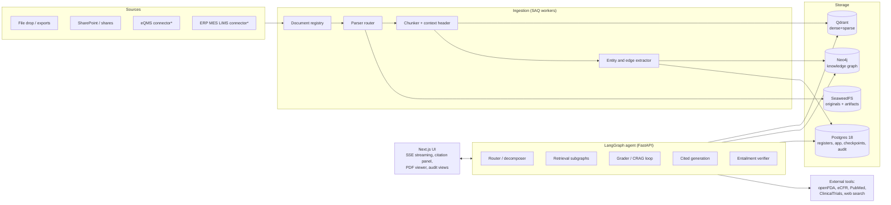

# Golden Goose — System Architecture

Agentic retrieval chat platform for live regulatory audit support at a Class 3 medical device company.
Version 0.1, 2026-07-17. Synthesized from a requirements interview and research reports 01 to 03 (`docs/research/`).

## 1. Purpose and operating context

During an FDA inspection (CP 7382.850, post-QMSR) or ISO 13485 / MDSAP audit, a backroom team must
produce exact, cited evidence within minutes: the current-effective SOP, a CAPA thread end-to-end, an
as-of-date training record, a requirement-to-validation trace. The same system serves audit prep
(gap-hunting) and everyday QA/RA work (CAPA investigation, complaint trending, change impact).

The system is a **read-only intelligence layer over the QMS** — it never modifies quality records.
Every answer carries verifiable citations (doc ID, revision, page/section). Every query, retrieved
source, and answer is written to an append-only audit log.

**Non-goals:** authoring or e-signing controlled documents; replacing the eQMS; making compliance
judgments without evidence; full 21 CFR Part 11 validation in v1 (the design is validation-ready).

## 2. Requirements summary (locked 2026-07-17)

| Dimension | Decision |
|---|---|
| LLM / embeddings / rerank | Hosted APIs (frontier LLM; Voyage embeddings + reranker) |
| Sources | File-drop/export baseline; connector abstraction for eQMS, SharePoint, ERP/MES/LIMS; scanned paper via OCR |
| Scale | Design point 5k–50k docs (~0.5–2M chunks); scale-out ready |
| Users | Multi-user: audit backroom, audit prep, daily QA/RA |
| Compliance posture | Citations mandatory; immutable audit log; read-only; validation-ready |
| Agent tools | Hybrid retrieval, graph traversal, warehouse SQL, DuckDB file queries, openFDA, eCFR/guidance, ClinicalTrials.gov/PubMed, web search, internal-API connectors |
| Dev corpus | Synthetic Class 3 QMS generator with seeded gaps = eval dataset |
| Deployment | Local Docker Compose first; cloud-neutral containers → AWS or Azure via Terraform later |
| Milestone 1 | End-to-end thin slice, every layer real |

## 3. Regulatory context that shapes the design

- **QMSR effective 2026-02-02**: 21 CFR 820 incorporates ISO 13485:2016; QSIT retired; FDA inspects
  under CP 7382.850 using the risk management file as the roadmap. Corpora straddle both eras →
  a **QSR↔ISO 13485 synonym layer** is applied at query time (DHF ≡ design & development file 7.3.10;
  DMR ≡ medical device file 4.2.3; DHR ≡ batch/production records 7.5.9).
- Inspectors trace multi-hop threads (complaint → CAPA → design change → risk file → management
  review). The inspection method is a graph traversal — this justifies a first-class knowledge graph.
- Auditors ask **as-of-date** questions ("what was in force on the day this lot shipped?") →
  revisions are first-class entities with effective-date ranges everywhere (Qdrant payloads, graph
  nodes, warehouse rows).
- 26 document families catalogued in research report 01, grouped by structural type: narrative
  controlled docs, Excel matrices, structured forms, production/logbook records, scanned legacy,
  CAD, regulated e-formats (eMDR HL7 XML, eSTAR, GUDID).

## 4. System overview


\* Connectors ship as interfaces in v1; file-drop/export is the universal baseline (eQMS assumed
immature — no API dependency).

## 5. Repository and runtime layout

**uv workspace monorepo**, Python 3.13, single lockfile:

```
golden-goose/
├── apps/
│   ├── api/            # FastAPI + LangGraph service (uvicorn entrypoint)
│   └── web/            # Next.js frontend (TypeScript)
├── packages/
│   ├── common/         # settings (pydantic-settings), models, provider adapters, telemetry
│   ├── ingestion/      # registry, parser router, chunkers, extractors, SAQ tasks
│   ├── retrieval/      # hybrid search, fusion, rerank, graph traversal tools, SQL tools
│   ├── agents/         # LangGraph graphs, nodes, prompts, tool registry
│   └── synthdata/      # synthetic QMS corpus generator + golden QA sets
├── infra/
│   ├── compose/        # docker-compose.yml + profiles (core, observability, ci)
│   ├── migrations/     # Alembic (Postgres), versioned Cypher (Neo4j)
│   └── terraform/      # AWS / Azure skeletons (phase 7)
├── docs/               # research, architecture, planning, ADRs
└── tests/              # cross-package integration + eval harness
```

**Container fleet** (limits sized for a 10 GB host; steady-state RSS ~5–6 GB):

| Container | Image (pinned) | Limit | Role |
|---|---|---|---|
| qdrant | qdrant/qdrant v1.18.x | 1.5 GB | Vectors: dense int8 + sparse BM25, server-side fusion |
| neo4j | neo4j 2026.06 community | 2.0 GB | Knowledge graph (768m heap / 512m pagecache) |
| postgres | pgvector/pgvector:pg18 | 1.0 GB | registers, app, checkpoints, audit + SAQ queue |
| seaweedfs | chrislusf/seaweedfs 4.x | 512 MB | S3-compatible originals/artifacts, object lock |
| api | golden-goose (uvicorn) | 768 MB | FastAPI + LangGraph, SSE |
| worker | golden-goose (saq) | 1.25 GB | Ingestion pipeline |
| web | Next.js standalone | 512 MB | UI |
| phoenix (profile) | arizephoenix/phoenix v19 | 768 MB | OTel/OpenInference tracing |

Key stack decisions (full rationale in research 03): **SeaweedFS replaces MinIO** (MinIO community
archived 2026-04); **SAQ on Postgres replaces Celery+Redis** (drops a container, async-native,
durable); **no IdP container** — Better Auth (Next.js) + JWT validation (FastAPI), users keyed on
OIDC `(issuer, subject)` so Cognito/Entra/Keycloak is a config swap; **Phoenix** for local tracing
(Langfuse v3 needs a 6-container ClickHouse stack). One app image, two entrypoints (api/worker) so
parse spikes cannot OOM chat.

## 6. Ingestion pipeline

### 6.1 Registry first

Every source file lands in SeaweedFS; a row in `app.documents` records content hash (sha256),
source path, detected format, doc-type classification, extracted doc number + revision, status
lifecycle (draft/effective/obsolete + effective_from/effective_to), and pipeline state. Content
hashing gives idempotency; re-ingestion of a changed file creates a new `document_versions` row —
never silent overwrite, so provenance is kept and vectors are not duplicated.

### 6.2 Parser router (route by document class, then by page)

| Class | Parser | Notes |
|---|---|---|
| Born-digital PDF / Word | **Docling** | Layout-aware; TableFormer tables; lossless JSON with page+bbox provenance → feeds citations directly |
| Excel matrices (FMEA, trace, control plan, logs) | **openpyxl native** | Row-as-record preserved; merged-cell forward-fill; multi-row header detection; template fingerprinting; synonym header mapping with manual override |
| Scanned pages | **VLM OCR (Gemini-class hosted)** | Page-level text-layer probe decides; confidence recorded per page and **enforced** (gate, not warning) |
| Regulated e-formats | Native parsers | eMDR HL7 XML, eSTAR, GUDID exports |
| CAD / drawings | Title-block + BOM extraction | Metadata only in v1 |

Pipeline is staged with filesystem/S3 artifacts between stages (parse → chunk → embed → index),
each stage idempotent and independently re-runnable. Deterministic UUIDv5 point IDs +
delete-before-upsert prevent orphaned vectors.

### 6.3 Ingestion QA gates — errors are data

Per-document `metrics.json`: chunks/page, text coverage %, OCR confidence distribution, table
extraction count, ID-extraction count, page-assignment no-match rate, seconds/page. Hard gates
abort and surface (zero chunks, coverage < threshold, OCR confidence below floor, >10% stage
failure). **No failure is ever converted into a plausible default.** Failed documents are
queryable as failed, which gives an honest "not in corpus."

Prompt-injection sanitization runs at ingestion on all extracted text
(`packages/ingestion/src/gg_ingestion/sanitize.py`).

## 7. Chunking, embedding, hybrid retrieval

- **Structural parent-child**: children 250–400 tokens on heading boundaries; parents = full
  section (≤2k tokens) stored in Postgres; retrieval returns children, generation sees parents
  (`group_by=parent_id`).
- **Chunk context header** (shipped): each child chunk is prefixed with a deterministic identity
  header (document key, revision, title, type) before both dense and sparse indexing, so every
  chunk carries its provenance into retrieval. This is `_context_header` in
  `packages/ingestion/src/gg_ingestion/chunking.py`.
- **Contextual prepending** (Anthropic-style LLM preamble) — *deferred, not in the current build.*
  The intended enhancement is a 50–100-token LLM-written (Haiku-class + prompt caching) semantic
  preamble per chunk, content-hash cached, applied to both vector legs with a visible degraded-mode
  signal when it cannot be produced. It is **not implemented**; the deterministic header above is
  the only per-chunk context that ships today. When it lands it must be additive to (not a
  replacement for) the identity header, and its absence must be observable rather than silent.
- **Per-structural-type policies**: FMEA = one chunk per row rendered with methodology banner,
  focus ancestry, effects/controls, S/O/D/AP + focus-level rollups and worksheet summaries; forms
  = whole if ≤800 tokens plus field extraction; batch records = per page/step, ID extraction over
  embedding; narrative = heading-based.
- **Embeddings**: Voyage `voyage-4-large`, 1024-dim Matryoshka, int8 in Qdrant. **Sparse**: Qdrant
  built-in BM25 — audit queries are dense with exact IDs (`SOP-023`, `CAPA-2024-118`) where dense
  vectors are unreliable.
- **Fusion**: Qdrant Query API, two prefetch branches (~100 each) fused with **RRF**; ACL + status
  filters injected server-side on every branch (never LLM-constructed).
- **Rerank**: Voyage `rerank-2.5` (32k context handles parent-expanded sections), 100–120 in →
  12–15 out; lite variant inside agent loops.
- **Payload/metadata** (projected from the Postgres registry, indexed before ingest): doc_id,
  doc_type, revision, status, effective_from/effective_to, product_codes, section_path, page,
  chunk_type, parent_id, acl_groups, ocr_confidence, source_hash. Default filter `status=effective`
  with explicit as-of-date override.

## 8. Knowledge graph (Neo4j)

**Schema-first, deterministic-extraction-first.** ~37 node types and typed edges from research 01
(design thread SATISFIES/VERIFIES/VALIDATES; risk thread MITIGATES/VERIFIES_CONTROL/
EVALUATED_AGAINST; production thread BUILT_PER/CONSUMED lot genealogy; CAPA hub SOURCED_FROM/
IMPLEMENTED_VIA/VERIFIED_BY; SUPERSEDES/CHANGED_BY revision chains), merged with an FMEA
ontology as native labels (CONTAINS, CAN_FAIL_AS, CAUSED_BY, MITIGATED_BY, ADDRESSES DFMEA→PFMEA,
REALIZED_IN → control plan) extended with ASSESSED_AS{stage}, TRACES_TO, VERIFIED_BY, LEADS_TO/
CREATES (ISO 14971 bridge).

- Edges come from **ranked deterministic sources**: trace matrices > DHF/DMR/RMF indexes > form
  fields > revision-history tables > References sections > inline regex validated against master
  registers. LLM extraction only for soft relations under a closed schema. Every edge carries
  provenance (`EXTRACTED_FROM{doc,sheet,row,col}` or page/bbox) and extraction confidence.
- **DocumentRevision is a first-class node**; temporal properties enable as-of traversals.
- ID regex bank (research 01 §conventions) with separator/zero normalization, footer
  self-reference suppression, OCR confusion folding (O↔0, I↔1, S↔5).
- **Traversal tools**: pre-canned parameterized Cypher (revision_history, capa_thread,
  trace_requirement, impacted_documents, lot_genealogy, training_as_of, feedback_loop_evidence) —
  read-only, schema-constrained. Gated Text2Cypher (neo4j-graphrag) as fallback behind a feature
  flag. Graph results join vector results via doc_id-filtered Qdrant fetch → unified rerank.
- Graph store sits behind a repository interface; FalkorDB documented as RAM-relief fallback.

## 9. Structured warehouse and file tools (Postgres + DuckDB)

`registers` schema: typed tables for NCR, CAPA, complaint, deviation, SCAR, audit findings,
training, calibration, plus normalized FMEA registers (rows/effects/causes/controls/actions/risk
assessments, sheet-value **and recomputed Action Priority with mismatch flag** — every mismatch is
a candidate audit finding). The text-to-SQL agent tool runs under a **sandboxed read-only role**
against curated views only. Trending questions ("all NCRs tied to supplier X in 2025, by month")
get exact SQL answers, never RAG guesses.

DuckDB powers the ad-hoc file tool: user-dropped CSV/Parquet/Excel queried in-session, read-only,
results cited by file+sheet+range.

## 10. Agent design (LangGraph 1.x StateGraph)

```
route → decompose (Send fan-out) → parallel retrieval subgraphs → grade (CRAG, ≤2 rewrites)
      → cite-mandatory generation → entailment verify → stream
```

- **Router** classifies query intent per the 10 audit patterns (procedure fetch, record listing,
  thread walkthrough, trace walk, as-of check, reconciliation diff, blast radius, currency sweep,
  Cl.10 evidence, as-built consistency) and selects tool families. Record-population counts route
  to graph/SQL, never embeddings.
- **Retrieval subgraphs** per family: hybrid vector, graph traversal, warehouse SQL, DuckDB files,
  external APIs (openFDA/MAUDE/recalls/GUDID, eCFR + FDA guidance, ClinicalTrials.gov, PubMed),
  web search (provider-abstracted, default Tavily), internal-API connectors.
- **Grading**: retrieval grader with bounded rewrite loops; empty scoped results return an honest
  "not in corpus" and never fall back to unscoped search, which could return documents outside
  the requested scope.
- **Generation**: citations required per claim; answers without grounded citations are blocked by
  the **entailment verifier** node and regenerated or downgraded to "insufficient evidence."
- **State**: PostgresSaver checkpointer; immutable state transitions; `interrupt()` escalation
  gates for quality-manager review flows. Per-node timeouts and retry policies.
- **Streaming**: `stream_mode="messages"` + custom events (citations, tool progress) over SSE.
- QSR↔ISO synonym expansion applied at query time; every response records model, prompt hash,
  retrieved chunk IDs, and tool calls into the audit log.

## 11. Frontend (Next.js)

Chat with token streaming and agent-step visibility; citation side panel that opens the original
PDF at page/bbox (Docling provenance) or the FMEA row/cell; register browser (NCR/CAPA/complaint
tables); audit-log viewer; saved audit-prep collections. Better Auth (OIDC-ready), roles:
admin / qa_user / auditor_readonly. SSE with `no-transform`; App Router; TypeScript strict.

## 12. Compliance, security, audit

- **Audit schema**: append-only (REVOKE UPDATE/DELETE + trigger enforcement + sha256 hash chain;
  app role does not own the table).
- **Original-document immutability**: originals are written under content-addressed, write-once
  keys (`doc_key/sha256/filename`) and never overwritten in place; every read-back is re-hashed
  against the registry's recorded sha256 (`read_verified`, fails closed on mismatch), so corruption
  or a swapped object is caught regardless of backend guarantees. Bucket versioning is enabled as
  defense-in-depth where the object-store backend supports it (native S3/MinIO; SeaweedFS may not).
- **ACLs**: one vocabulary (`gg_common.acl`) labels complaint/MDR/eMDR content restricted; a
  server-injected `access_level` filter on every Qdrant prefetch, per-role relation whitelisting
  in the SQL guard backstopped by Postgres RLS (transaction-local `gg.read_restricted` flag),
  and a restricted-key gate on graph anchors. All fail closed; audit-prep endpoints additionally
  require qa_user/admin.
- Secrets via env/dotenv only; pinned images; internal-only DB networking; rate limiting on API;
  inputs validated at boundaries (Pydantic); SQL tool sandboxed; no secrets in logs.
- Validation-ready: intended-use statement, requirements traceability for the app itself, and the
  eval harness double as objective evidence if formal CSA validation is later required.

## 13. Evaluation and observability

- **Synthetic corpus** (`packages/synthdata`): generates a coherent fake Class 3 device company —
  cross-referenced SOPs, DHF, FMEAs, risk file, NCR/CAPA/complaint/MDR threads, batch records,
  training matrix — with **seeded gaps** (broken traces, overdue reviews, AP mismatches) and a
  150–300-pair golden QA set with labeled evidence IDs.
- **Metrics**: recall@5/10/20, MRR, nDCG@10 (ranx) measured post-fusion and post-rerank;
  DeepEval pass/fail gates in CI (PR smoke ~30 Qs; nightly full run); RAGAS (incl. NoiseSensitivity)
  for tuning dashboards; custom citation-entailment gate; per-node evals for router/grader/
  Text2Cypher.
- **Observability**: OTel + OpenInference everywhere; Phoenix locally; LangSmith/Langfuse
  reachable in cloud via the same instrumentation. Stage-by-stage retrieval health endpoint
  (`/health/retrieval`).

## 14. Cloud extensibility map

| Local | AWS | Azure |
|---|---|---|
| Docker Compose | ECS Fargate | Container Apps |
| Qdrant container | Qdrant Cloud / ECS | Qdrant Cloud / ACA |
| Neo4j Community | Aura / marketplace | Aura / VM |
| Postgres 18 | RDS | Azure Database for PostgreSQL |
| SeaweedFS (S3 API) | S3 | Blob (native via ObjectStore interface) |
| Better Auth OIDC | Cognito | Entra ID |
| Phoenix | LangSmith/Phoenix on ECS | LangSmith/Phoenix on ACA |

Everything reaches storage through thin adapters (ObjectStore, GraphStore, VectorStore, Queue) so
the swap is configuration + Terraform, not code (adapters are thin — no premature abstraction
beyond these four seams).

## 15. Key risks and mitigations

| Risk | Mitigation |
|---|---|
| Real-world FMEA/trace-matrix template chaos | Template fingerprinting + synonym mapping + manual-override UI; `needs_manual` instead of coercion |
| OCR quality on wet-signature legacy | Enforced confidence gates; never assert low-confidence values; page-level provenance |
| Hallucinated compliance claims | Entailment verifier + citation-mandatory generation + honest not-in-corpus |
| Scope creep before M1 | Thin-slice milestone discipline; 5 doc types end-to-end before breadth |
| API cost surprises | Embedding cache keyed by content hash; per-turn cost telemetry (ADR-0017). Contextual-prepend cost controls (cached Haiku-class calls) apply only once that deferred feature lands |
| Stack drift / silent breakage | uv lockfile, pinned images, CI eval gates, dependency audit |
